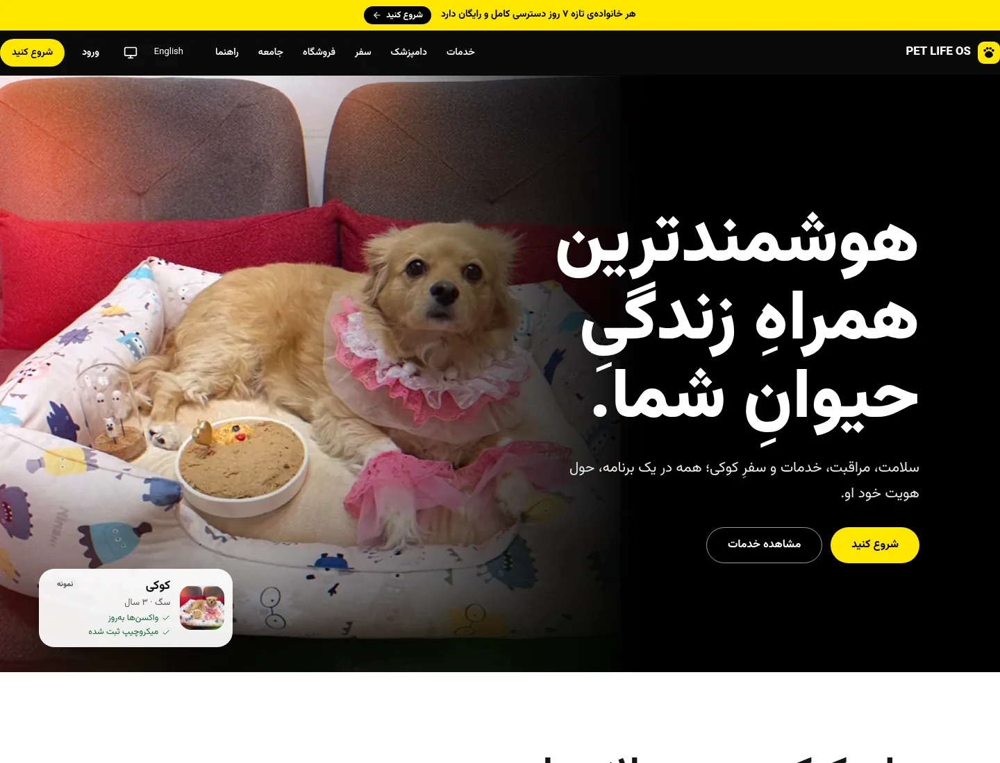
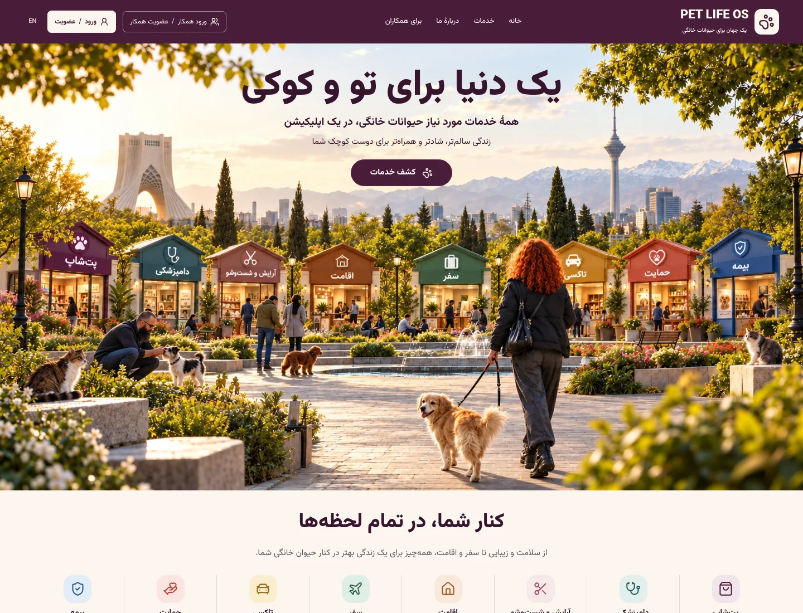
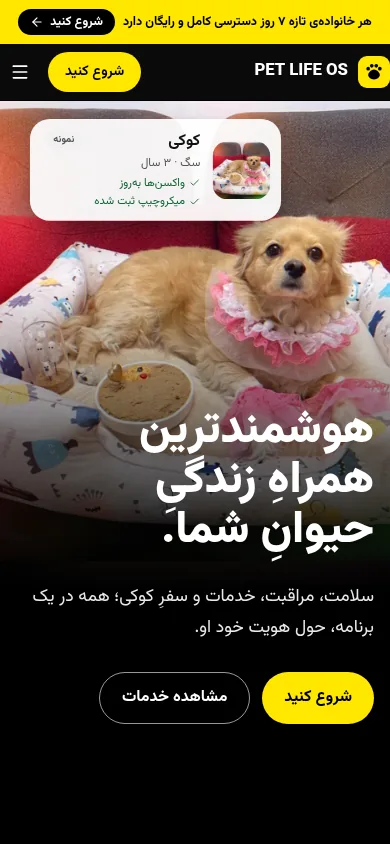
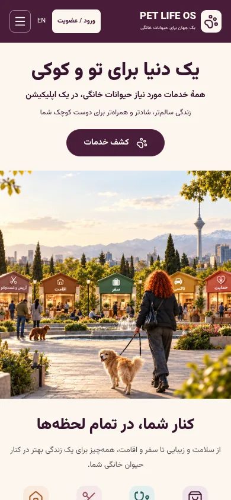
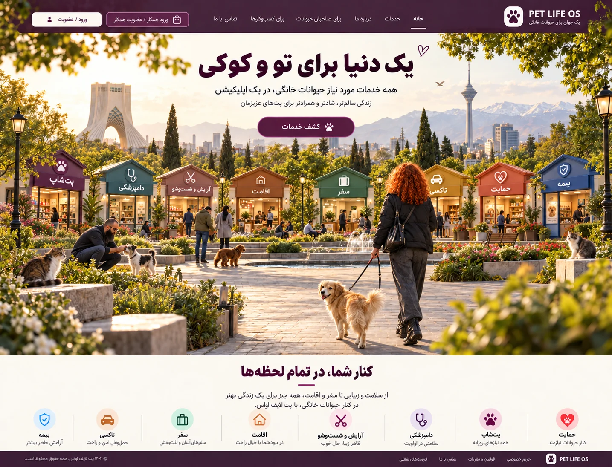

# Approved Tehran park landing

Branch: `codex/stab-landing-tehran-park`  
Base: `stabilization/wave-1`  
PR: not opened; pending the repository-wide typecheck prerequisite and GitHub API access.  
Board #4 line to publish: `codex/stab-landing-tehran-park — PR pending — approved landing implemented; frontend/browser validation complete; full gate blocked by Prisma download access.`

## What changed

The public landing starts with the owner-approved Tehran park. Tara walks Cookie into the scene, Pedram pets a black-and-white terrier, and eight pavilions lead to actual product routes. Live RTL/LTR UI supplies the title, CTA, account/partner entry points, keyboard-accessible destinations and responsive service shortcuts. The existing content continues below the hero.

Supporting changes: semantic campaign tokens, transparent artwork/photo credits and licence links, and self-hosted OFL-licensed Inter/Vazirmatn font files to remove the Google Fonts build-time network dependency. Existing route tests now also verify that in-page links resolve to actual section IDs; no assertions or suites were disabled.

## Before / after (Persian)

| Viewport | Before | After |
| --- | --- | --- |
| 1440 × 1100 |  |  |
| 390 × 844 |  |  |

Approved design: 

## Owner summary

لندینگ بر اساس پارک تأییدشده، تارا و کوکی و هشت غرفهٔ خدمات پیاده‌سازی شد.
نسخهٔ فارسی و انگلیسی، موبایل و دسکتاپ، ناوبری و تصاویر قبل و بعد بررسی شده‌اند.
این شاخه برای بررسی است؛ ادغام، انتقال به main و دیپلوی انجام نشده است.

## Validation

- Frozen-lockfile installation: passed; package manifests and lockfile unchanged.
- Repository lint: passed (10 warnings, no errors).
- Frontend TypeScript: passed.
- Full web suite: 157 test files, 612 tests passed; no skipped/disabled tests.
- Focused landing/navigation checks: 16 passed; included in the full web suite.
- Chromium: fa/en at 390 and 1440, no horizontal overflow, no runtime errors or broken images; mobile menu, reduced motion, focus return and real taxi route checked.
- Repository-wide TypeScript: blocked/failed in the API on missing generated Prisma definitions; verified engine download returned HTTP 403.

See `design-qa.md`, `browser-checks.json` and `interaction-checks.json`. Full repository TypeScript currently fails in the API because Prisma generation cannot download verified engines (HTTP 403). API source was not changed to work around that restriction. Do not merge or deploy until the normal CI/QA gate is green.
